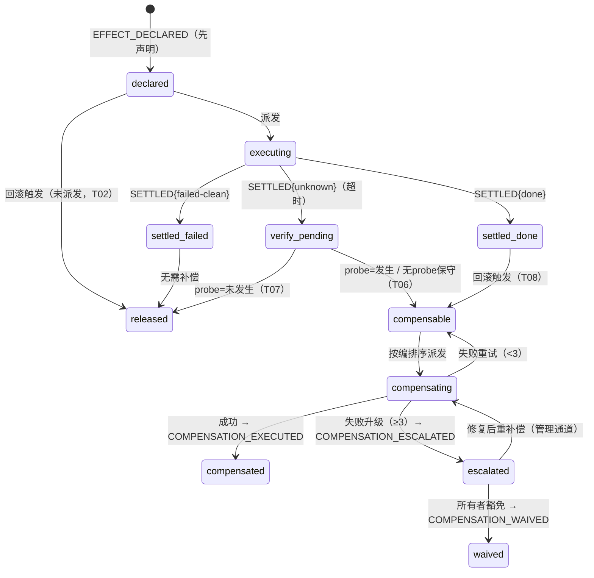

# 补偿事务状态机

- 状态：定稿（2026-11-02 所有者确认；同日修订（所有者评审澄清）：T2 重试受升级阻断约束（§5.1）、恢复补偿作用域澄清（§3））
- 日期：2026-11-02
- 关联：[01-core-api-contract](01-core-api-contract.md)（§4.5 恢复顺序、§5 事件表、§6 超时语义）；[ADR-0004](../../adr/ADR-0004-ledger-consistency-point.md)；[ADR-0005](../../adr/ADR-0005-cell-isolation.md)（补偿执行入口）；[phase-0](../../roadmap/phase-0-design-baseline.md)（验收 A6、V4）

## 1. 背景

设计简报的两个判定是本文的公理：**"卸载即无痕"不成立**（V4），**承认不是所有操作可逆，但所有操作必须有补偿路径**。DSH 的 effect 回收之所以失效，在于回收是"事后尽力"——没有事前声明、没有状态机、没有失败路径。本文把补偿做成一等机制：**每个越界副作用先声明后执行**，声明携带补偿计划；补偿的执行、失败、升级全部有状态、有事件、可重放。

设计输入（所有者已确认，2026-11-02）：

- **S4-1 失败处置链**：重试 ≤3 → 升级阻断（未决污染清单 + 告警 + 阻断恢复续跑）→ 所有者显式豁免留痕。
- **S4-2 补偿分级**：reversible / mitigable / record-only 三级，manifest 必填枚举。

## 2. 目标与不覆盖

**覆盖**：效果（effect）记录的生命周期状态机与账本事件；补偿触发点与编排顺序；超时未知的核验语义；幂等契约与崩溃重入；补偿分级语义；补偿失败的升级与豁免路径。

**不覆盖**：manifest schema 的载体格式（任务 C——本文只定义它必须表达的字段）；核验动作（probe）的具体实现；观测插件的告警通道实现；跨 Run 的分布式事务（不存在——补偿永不跨 Run 边界，I5）。

## 3. 方案总览

- **Saga 式效果记录**：一次越界副作用 = 一条效果记录（effect record），状态机的**唯一事实来源是账本事件流**；Host 层补偿执行器（ADR-0005 §决策 5）持有的是可随时重放重建的投影——执行器自身崩溃不丢状态（I3）。
- **声明先行（D1）**：Cell 侧发起越界操作前，Core 先写 `EFFECT_DECLARED` 并登记补偿计划，**无声明不执行**——I4 的时序保证。账本写入仍由 Core 统一执行（单写者不变，契约 §3.3），执行器经 Core 内部接口申报结果。
- **补偿永不跨 Run**：效果记录归属 Run（从而归属 Cell/Scope），编排集合 = 本 Run 未闭环效果。恢复场景同样如此（2026-11-02 修订）：旧 Run 的未决补偿与核验在**原 runId 作用域内**闭环（或豁免）后，才以新 runId 延续；新 Run 不继承任何未决效果（契约 §4.5）。
- **七项本文内决策**：D1 声明先行；D2 未知保守视同已发生；D3 三级分级；D4 重试→升级→豁免；D5 回滚深度语义（§5）；D6 幂等三策略（§6）；D7 执行器投影 + 账本事实源（本节）。

## 4. 状态机

### 4.1 状态定义

| 状态             | 含义                       | 进入事件                                             |
| ---------------- | -------------------------- | ---------------------------------------------------- |
| `declared`       | 已声明未派发               | EFFECT_DECLARED                                      |
| `executing`      | 已派发，执行中             | —（派发不单独立事件，EFFECT_SETTLED 前即 executing） |
| `settled-done`   | 结果确定：已发生           | EFFECT_SETTLED{done}                                 |
| `settled-failed` | 结果确定：未发生且干净失败 | EFFECT_SETTLED{failed-clean}                         |
| `verify-pending` | 结果未知（超时），待核验   | EFFECT_SETTLED{unknown}                              |
| `compensable`    | 已发生且被纳入回滚集合     | —（投影态，由触发点标记）                            |
| `released`       | 终态：无需补偿             | —（投影终态；账本以 SETTLED 事件为凭）               |
| `compensating`   | 补偿动作已派发             | —（投影态）                                          |
| `compensated`    | 终态：补偿完成             | COMPENSATION_EXECUTED                                |
| `escalated`      | 终态-阻塞：补偿失败升级    | COMPENSATION_ESCALATED                               |
| `waived`         | 终态：所有者豁免           | COMPENSATION_WAIVED                                  |

> 投影态（compensable/compensating/released）不立账本事件——由事件流重放可推导；账本只记事实（声明/结果/补偿闭环/升级/豁免）。

### 4.2 状态转移表

| #   | 从             | 触发                                         | 守卫                     | 到                        | 动作/事件                                |
| --- | -------------- | -------------------------------------------- | ------------------------ | ------------------------- | ---------------------------------------- |
| T01 | declared       | 派发成功                                     | —                        | executing                 | —                                        |
| T02 | declared       | 回滚触发（尚未派发）                         | —                        | released                  | 取消派发                                 |
| T03 | executing      | EFFECT_SETTLED{done}                         | —                        | settled-done              | —                                        |
| T04 | executing      | EFFECT_SETTLED{failed-clean}                 | —                        | settled-failed → released | 失败原因入账本                           |
| T05 | executing      | EFFECT_SETTLED{unknown}（超时）              | —                        | verify-pending            | 契约 §6：结果未知必须核对                |
| T06 | verify-pending | probe 返回"已发生"或**无 probe（保守，D2）** | —                        | compensable               | 核验结论入账本                           |
| T07 | verify-pending | probe 返回"未发生"                           | probe 必须已声明         | released                  | 核验结论入账本                           |
| T08 | settled-done   | 回滚触发（T1/T2/T3，见 §5）                  | compensationClass ≠ 免除 | compensable               | —                                        |
| T09 | compensable    | 补偿派发（按 §5 编排序）                     | —                        | compensating              | —                                        |
| T10 | compensating   | 补偿成功                                     | attempts ≤ 3             | compensated               | COMPENSATION_EXECUTED{attempt}           |
| T11 | compensating   | 补偿失败，attempts < 3                       | —                        | compensable               | 退避后重派（≤30s）                       |
| T12 | compensating   | 补偿失败，attempts ≥ 3                       | —                        | escalated                 | COMPENSATION_ESCALATED；Run 标记恢复阻断 |
| T13 | escalated      | 所有者豁免                                   | 所有者显式通道           | waived                    | COMPENSATION_WAIVED{reason}              |
| T14 | escalated      | 所有者修复后重补偿                           | 管理通道                 | compensating              | attempts 归零                            |

### 4.3 状态图

### 4.4 与契约事件表的衔接

契约 §5 已有 `EFFECT_DECLARED` / `COMPENSATION_EXECUTED`（本文细化其载荷）；**新增三类**（对契约的修订已带日期注记）：`EFFECT_SETTLED`、`COMPENSATION_ESCALATED`、`COMPENSATION_WAIVED`。

## 5. 补偿触发点与编排（D5）

### 5.1 触发点

| 触发 | 场景                                                   | 回滚集合                                                                                                                    |
| ---- | ------------------------------------------------------ | --------------------------------------------------------------------------------------------------------------------------- |
| T1   | 轮失败且不再重试（含 hook③ give-up）                   | 本轮 compensable 效果                                                                                                       |
| T2   | 轮失败且重试                                           | 本轮效果先补偿清空，再重试轮（干净重试）；**若清空补偿中出现 escalated 未豁免效果，重试轮同样被阻断，走升级处置路径（§8）** |
| T3   | Run 失败 / 恢复对账（ADR-0005 `exited` 态、契约 §4.5） | 全 Run compensable 效果；**先核验 verify-pending，再补偿，最后才准续跑**                                                    |
| T4   | 预算耗尽 graceful（契约 §4.3）                         | 只核验 unknown，**不回滚已完成**（语义：收尾，非撤销）                                                                      |
| T5   | `run.cancel`                                           | 全 Run compensable（halt 语义）                                                                                             |

### 5.2 编排顺序

- 效果声明携带 `dependsOn[effectId]`（DAG，声明期校验，成环即拒绝声明）。
- 回滚按**逆拓扑序**（LIFO 依赖序，设计简报 §6.2）；无依赖关系的效果**有界并行**（默认并发 4，可配）。
- 编排集合内若有 `escalated` 未豁免效果：其余照常执行，但 **Run 恢复续跑被阻断**（`recover.execute` 返回 `RECOVER/COMPENSATION-FAILED`，契约 §6"升级处置"由此定义）。

## 6. 幂等契约与崩溃重入（D6）

- **effectId** = `runId + 单调序号`，Run 内唯一；一切补偿动作以 effectId 为引用键。
- 声明必填**幂等策略**三选一：

| 策略            | 语义                                                     | 适用                  |
| --------------- | -------------------------------------------------------- | --------------------- |
| `natural`       | 动作天然幂等（同参重放无额外效果）                       | 删除类、状态置位类    |
| `keyed`         | 目标系统按 effectId 去重（动作携带 effectId 作为幂等键） | 支付冲正、外部 API 写 |
| `probe-guarded` | 先 probe 查目标再动作（check-then-act）                  | 无幂等键的外部系统    |

- **硬规则**：补偿动作必须容忍"目标不存在/未发生"（T06 保守补偿的安全前提）。
- **崩溃重入（A6 路径二）**：执行器在任意点崩溃 → 重放账本事件流重建投影 → 无 `COMPENSATION_EXECUTED` 的 compensable 效果一律重派——幂等策略保证重派无害。

## 7. 补偿分级（D3，A6 路径三）

| class         | 语义                               | 补偿动作示例                                  | 闭环条件                  |
| ------------- | ---------------------------------- | --------------------------------------------- | ------------------------- |
| `reversible`  | 存在真逆动作，逆后系统回到前态     | 删除已建临时文件；调用外部系统的撤销/删除 API | 逆动作成功                |
| `mitigable`   | 不可逆但可缓解：降低或标注既有影响 | 发更正函；支付冲正；外部记录标记作废          | 缓解动作成功              |
| `record-only` | 完全不可逆：无任何外部补救手段     | —（动作即"强制留痕 + 告警"）                  | 审计记录持久化 + 告警发出 |

- record-only 不是"放弃补偿"：它的补偿动作 = 观测通道告警 + 账本留痕（保持"所有操作必须有补偿路径"字面成立）；其执行器闭环以审计持久为准。
- 三级为 manifest **必填枚举**（任务 C 校验）：声明者必须逐个副作用回答"出了事怎么收尾"；record-only 申报在账本中显式可见（审计归因要点）。

## 8. 失败路径：升级与豁免（D4，S4-1）

1. 补偿失败 → 退避重试（≤3 次，间隔 ≤30s，T11）；
2. 耗尽 → `COMPENSATION_ESCALATED`：效果进入**未决污染清单**（账本死信区，按 Run 组织），观测插件收到告警事件，Run 标记"恢复阻断"；
3. 所有者两条出路：**豁免**（`COMPENSATION_WAIVED`，接受残留影响，留痕归因）或**修复后重补偿**（管理通道，attempts 归零，T14）；
4. **禁止静默放弃**：不存在"重试几次后只记日志继续跑"的路径——那是被简报点名的退化形态。

## 9. 事件 schema（契约 §5 增量）

公共信封见契约 §5。载荷要点：

| 事件                     | 载荷                                                                                                                                                                                              |
| ------------------------ | ------------------------------------------------------------------------------------------------------------------------------------------------------------------------------------------------- |
| `EFFECT_DECLARED`        | effectId、kind、targetSummary、compensationClass、compensation{actionRef, paramsDigest, idempotency: natural\|keyed\|probe-guarded}、probe{ref}\|null、dependsOn[]、retention（账本载荷留存级别） |
| `EFFECT_SETTLED`         | effectId、outcome: done\|failed-clean\|unknown、error?、usageDigest?                                                                                                                              |
| `COMPENSATION_EXECUTED`  | effectId、attempt、resultDigest、durationMs                                                                                                                                                       |
| `COMPENSATION_ESCALATED` | effectId、attempts、lastError、blockedResume: true                                                                                                                                                |
| `COMPENSATION_WAIVED`    | effectId、waivedBy（所有者通道标识）、reason                                                                                                                                                      |

> 声明中 `paramsDigest` / `retention` 落实 standards/06 脱敏纪律：副作用参数按声明级别留存，敏感载荷默认摘要。

## 10. 验收（对应 phase-0 A6、V4）

- [ ] **A6-1 补偿自身失败**：桩补偿动作前 3 次失败 → 观察到 T11 两次重试 → 第 3 次后 `COMPENSATION_ESCALATED` + 告警 + `recover.execute` 返回 `RECOVER/COMPENSATION-FAILED`；豁免后恢复可续跑且 `COMPENSATION_WAIVED` 可重放。
- [ ] **A6-2 幂等重入**：补偿派发后 kill 执行器 → 重放账本重建投影 → 同 effectId 重派且目标系统无重复副作用（keyed 桩按 effectId 去重）。
- [ ] **A6-3 不可逆降级**：record-only 效果触发回滚 → 审计留痕 + 告警闭环，状态 `compensated`，不因"无法撤销"而失败。
- [ ] **V4 卸载即无痕**：Run 中途失败 → T3 全 Run LIFO 补偿 → 账本中每个已发生效果均有对应 `COMPENSATION_EXECUTED`（或有意识豁免记录）——"无痕"从不被宣称，"有账"可机械验证。
- [ ] **T06 保守补偿**：无 probe 效果超时 → 视同已发生被补偿；补偿动作对不存在目标安全（natural 桩验证）。

## 11. 自检清单（五大不变量对照）

- **I1**：补偿编排由 Host 执行器按本文状态机执行，策略插件无触发权（hook④ 只选停止模式，契约 §4.8）；账本写入仍 Core 单写者（§3）。
- **I2**：执行器崩溃不丢状态（投影可重放，D7）；补偿永不跨 Run 边界；单效果补偿失败只升级该 Run 恢复，不扩散其他 Run（§5.2）。
- **I3**：状态机唯一事实源 = 账本事件流（§3）；崩溃重入按 §6 重放重建；恢复先核验再补偿再续跑（T3，ADR-0004 闭环）。
- **I4**：声明先行（D1）+ 无声明不执行；record-only 保持"必有补偿路径"字面成立（§7）；升级阻断 + 豁免留痕，禁止静默放弃（§8）。
- **I5**：效果记录归属 Run/Scope；补偿编排集合不越界（§3）；参数留存按声明级别脱敏（§9）。

## 12. 风险

| 风险                               | 预案                                                             |
| ---------------------------------- | ---------------------------------------------------------------- |
| 声明负担迫使 plugin 作者乱填 class | 任务 C 校验 + 示例库；record-only 显式可见形成申报压力（§7）     |
| probe 实现成本高                   | probe 可选；保守补偿兜底正确性，probe 只是减少误补偿的优化（D2） |
| LIFO 依赖序在长链效果上补偿耗时长  | 有界并行；编排延迟入 Phase 1 基准；超长链属设计味道（提示拆轮）  |
| key 外部系统不支持幂等键           | probe-guarded 兜底策略（§6）                                     |

## 13. 待决问题

| 问题                                                              | 决定时限                                             |
| ----------------------------------------------------------------- | ---------------------------------------------------- |
| 未决污染清单的巡检/清理工具形态（现在 = 账本查询 + 手工豁免通道） | Phase 1 实现期；若所有者要求专用命令行，登记 backlog |
| `keyed` 策略在目标系统不支持去重时的探测方法                      | 实现期按插件沉淀示例                                 |
| 补偿动作的重试/退避参数可配置面（当前固定 ≤3 次 / ≤30s）          | Phase 1 基准后回评                                   |
