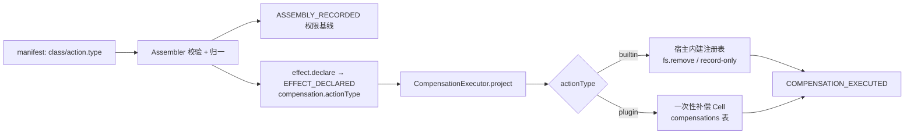

# Phase 3 切片③（二）：内置补偿模板与 record-only 极简声明

- 状态：**定稿**（2026-11-03 所有者要求“不可逆的治理变成无感的框架能力”后定稿；实现随切片③）
- 日期：2026-11-03
- 关联：[04 稿](04-cell-runtime-aop.md)（AOP 自动声明）；[DX 对比报告](06-dx-compensation-report.md)；[补偿状态机](../phase-1/02-compensation-state-machine.md) §7/§9；[manifest 稿](../phase-1/03-plugin-manifest.md) §5.4；[ADR-0016](../../adr/ADR-0016-builtin-compensation-registry.md)

## 1. 这份文档回答什么

写一个有副作用的插件，最容易劝退开发者的不是正向业务，而是“还要手写撤销逻辑”。本稿把补偿从“每个插件自己的作业”变成**框架内建能力**：

- manifest 已允许 `action.type: "builtin"`，但宿主补偿执行器过去只认插件动作 Cell，**builtin 分发从未实现**；
- `record-only` 过去虽然不需要插件写撤销代码，但 manifest 仍被强制填写 `action` / `idempotency`，这是无意义的仪式；
- 本稿定义 **builtin 注册表**、**宿主侧执行**、**`fs.remove` 首个内建**、**record-only 极简模板**，以及 **`EFFECT_DECLARED` 的 `actionType` 标注**。

目标：写一个带补偿的 `file-writer`，插件代码里 **零撤销代码、零治理胶水**；撤销由底座按 manifest 执行。

## 2. 事实核对

| #   | 事实                                                                                                                                               | 含义                                                                                              |
| --- | -------------------------------------------------------------------------------------------------------------------------------------------------- | ------------------------------------------------------------------------------------------------- |
| F1  | `keel-plugin.schema.json` 的 `compensation.templates[].action.type` 已经是 `plugin \| builtin`；`CompensationTemplateDecl` 也保留了 `builtin` 类型 | 报关单的“声明面”早就有位置，缺的是执行面                                                          |
| F2  | `CompensationExecutor.compensate` 对非 `record-only` 候选一律 `requireFactory()` 拉起一次性补偿 Cell；`compensateOne` 只走 `cell.exec`             | builtin 声明会被当成插件动作，派到不存在的 actionRef → 失败/升级                                  |
| F3  | `EFFECT_DECLARED` 只带 `actionRef` / `paramsDigest` / `idempotency`，**不带动作类型**                                                              | 补偿执行器无法从账本区分“该找插件 Cell”还是“该走内建”                                             |
| F4  | `ASSEMBLY_RECORDED.permissions` 带 `fs.write` 的 `allow` 清单（装配时已裁决的面）                                                                  | 内建删除可以在宿主侧复核路径白名单，不新增权限面                                                  |
| F5  | 补偿触发在宿主（失败/取消/恢复时按状态机）；Cell 只负责声明                                                                                        | AOP 不能也不该“在 handler 后直接撤销”；它只保证声明先于副作用                                     |
| F6  | 插件 B 需求卡把撤销定义为“删除该文件”；`fs.remove` 正好覆盖                                                                                        | 首个内建选 `fs.remove`，不发明通用撤销语言                                                        |
| F7  | 网络请求没有通用逆操作；`net.fetch` 的补偿天然依赖对方 API（撤销/冲正/作废）                                                                       | 网络类内置能力 = **record-only**（审计 + 告警）；真正的撤销仍可由插件声明 `action.type: "plugin"` |

## 3. 方案

### 3.1 总览



### 3.2 builtin 注册表（宿主）

```ts
// packages/host/src/builtins.ts
export interface BuiltinActionContext {
  ref: RunRef;
  effect: EffectProjectionEntry; // 含 targetSummary / paramsDigest
  permissions: { cap: string; allow?: string[] }[]; // 来自 ASSEMBLY_RECORDED
}

export interface BuiltinAction {
  ref: string;
  exec(ctx: BuiltinActionContext): Promise<ToolResultLike>;
}

export const BUILTIN_REFS = new Set(["fs.remove", "record-only"]);
export const DEFAULT_BUILTINS: ReadonlyMap<string, BuiltinAction> = new Map([...]);
```

- `CompensationExecutor` 新增可选 `builtins`（默认 `DEFAULT_BUILTINS`）；测试可注入替身。
- `compensate` 的 `needCell` 改为：只有 **非 record-only 且 actionType ≠ builtin** 的候选才需要补偿 Cell。纯内建/record-only 的 run 不再 spawn 第二个进程。
- `compensateOne` 的 retry/escalate 循环不变；只把动作来源从 `cell.exec` 换成内建 `exec`。错误仍按 `COMPENSATION_ESCALATED` 升级，不新增错误码。

### 3.3 `fs.remove`（首个内建）

语义：**删除本次正向操作创建的那个文件**；必须容忍文件不存在（T06 硬规则）。

- 目标：`targetSummary.path`（AOP 的 `effects[].targetFields` 必须包含 `path`）。
- 路径：必须是绝对路径；拒绝相对路径（宿主 cwd 与 Cell cwd 不一定相同）。
- 权限：从本 run 的 `ASSEMBLY_RECORDED.permissions` 取 `fs.write.allow`，用 `globMatch` 复核 `fs:` + 归一化路径；不匹配 = 拒绝（不回退到“无规则 = 允许”）。
- 执行：`rm(path, { force: true })`（不递归；目录目标报错并按补偿失败重试/升级）。
- 结果：`COMPENSATION_EXECUTED{resultDigest:{removed:path}}`。
- 边界：**覆盖写不是 `fs.remove` 的语义**——删除会丢掉旧内容。覆盖写应声明 `record-only`，或用插件补偿；备份/恢复型内建（`fs.restore`）登记 backlog，不在本片承诺。

### 3.4 record-only 极简声明

manifest 从“还要写无意义的 action/idempotency”简化为：

```json
"compensation": {
  "templates": [
    { "kind": "notify.sent", "class": "record-only" }
  ]
}
```

- 装配器归一：缺失的 `action` → `{type:"builtin", ref:"record-only"}`；缺失的 `idempotency` → `"natural"`。
- Schema：模板的必填从 `["kind","class","action","idempotency"]` 收窄为 `["kind","class"]`；用 `if/then` 对 `reversible` / `mitigable` 继续强制 `action` + `idempotency`（校验器支持 `if/then`/`enum`，不新增关键词）。
- `EFFECT_DECLARED` 仍带完整的 `actionRef:"record-only"`、`actionType:"builtin"`、`idempotency:"natural"`，账本形状不残缺；补偿执行器走既有 record-only 直闭（审计 + 告警）。
- 插件无需导出 `compensations`；`main.ts` 已把该导出视为可选。

### 3.5 `actionType` 写入 `EFFECT_DECLARED`

- `cell-server.declareEffect` 从 manifest 模板取 `action.type`，写入 `compensation.actionType`（`plugin` / `builtin`）。
- `EffectDeclaredPayload.compensation.actionType` 为**可选追加字段**；旧账本缺失 = 按 `plugin` 读（向后兼容）。
- 补偿执行器只在**候选动作**上使用它；`project` 的其它字段不变。

### 3.6 装配期校验（fail-closed）

- `action.type:"builtin"` 的 `ref` 必须命中 `BUILTIN_REFS`；未知内建 → `SCHED/MANIFEST-INVALID`（不等到运行期才炸）。
- `class:"record-only"` 的模板若显式给了 `action`，保留但不执行；若 `type:"builtin"` 仍按上面的闭集校验。
- 越界能力（`fs.write`）的补偿模板非空规则不变；一个极简 `record-only` 模板也算“有补偿路径”。
- `ASSEMBLY_RECORDED` 的 `compensation` 摘要不改形状；`actionType` 在 `EFFECT_DECLARED` 上，审计可按效果追溯。

## 4. 与 AOP 的关系

- **AOP 负责“声明”**：handler 前自动 `EFFECT_DECLARED`；`fs.remove` 需要的 `targetSummary.path` 由 manifest `effects[].targetFields` 产生。
- **宿主负责“触发与执行”**：失败/取消/恢复时按状态机补偿；builtin 在宿主执行，plugin 才 spawn 补偿 Cell。
- 插件作者只写正向业务；manifest 只声明“哪个工具、哪种效果、用哪个内建/插件动作”。撤销代码不再是插件作者的作业。

## 5. 验收（切片③）

- **B1**：装配器接受 `class:"record-only"` 缺失 `action`/`idempotency`，归一为 builtin/record-only + natural；`reversible` 缺失仍拒绝。
- **B2**：未知 builtin ref → `SCHED/MANIFEST-INVALID`。
- **B3**：`cell-server` 对 builtin/plugin 模板分别写 `compensation.actionType`；旧账本缺失时投影默认 `plugin`。
- **B4**：`fs.remove` 在白名单路径内删除文件，写 `COMPENSATION_EXECUTED`，**不调用** ActionCellFactory。
- **B5**：白名单外路径 → 拒绝（`lastError` 带 `AUTH/DENIED` 语义），重试后 `COMPENSATION_ESCALATED`，文件仍在。
- **B6**：目标文件不存在 → 成功（`force:true`，T06）。
- **B7**：纯 builtin/record-only 的 run，`compensate` 不 spawn 补偿 Cell（factory 零调用）。
- **B8**：真实 `file-write` fixture 端到端：AOP 自动声明 → 注入 run 失败 → `fs.remove` 删文件 → 账本 `EFFECT_*` / `COMPENSATION_EXECUTED` 全链。
- **门禁**：六道门禁全绿；新增代码单文件 ≤600 行。

> 2026-11-03 实现证据：B1/B2 见 `packages/host/test/assembler.test.ts`；B3 见 `cell-server.test.ts`；B4~B7 见 `packages/host/test/compensator.test.ts`；B8 由 `tests/native-file-write-aop.test.ts` 的 A3（注入 run 失败 → `fs.remove` 自动删文件）承担。

## 6. 不做什么（明确边界）

- **不做通用网络撤销**：HTTP 没有通用逆操作；网络类用 `record-only` 或插件自定义补偿。未来如做 `net.request` 内建，必须显式声明撤销请求，且单独 ADR。
- **不做 `fs.restore`（备份/覆盖恢复）**：需要 pre-image 捕获与备份生命周期；登记 backlog，不在本片承诺。
- **不做递归删除**：`fs.remove` 只删单文件；目录内建另案。
- **不绕过授权**：内建路径复核 `ASSEMBLY_RECORDED` 的 `fs.write.allow`；没有基线就拒绝（fail-closed）。
- **不改变补偿状态机**：重试、升级、豁免、依赖序全部沿用。

## 7. 风险

| 风险                                | 应对                                                                                   |
| ----------------------------------- | -------------------------------------------------------------------------------------- |
| 把 `fs.remove` 当成“万能写文件撤销” | 文档明确：只适用于“新建文件”；覆盖写走 record-only/插件补偿                            |
| 内建执行在宿主，绕过 Cell 隔离      | 只执行闭集内建；路径按本 run 的 `fs.write.allow` 复核；失败按状态机升级                |
| 旧账本无 `actionType`               | 投影默认 `plugin`；旧行为不变                                                          |
| record-only 放宽后被滥用            | `class` 仍是必填；record-only 在账本显式可见（申报压力设计）；不提供“默认 record-only” |
| 内建与插件动作同名                  | 装配期按 `action.type` 区分；`builtin` ref 走闭集，插件 ref 走插件表                   |

## 8. 自检清单

- **I1**：补偿触发与执行仍在宿主控制面；Cell 不能自触发。
- **I2**：内建不新开 Cell；失败仍按既有重试/升级，不级联 run。
- **I3**：`ASSEMBLY_RECORDED` + `EFFECT_*` 仍是唯一事实源；`actionType` 可从账本重放。
- **I4**：每个有副作用的效果仍有补偿路径；record-only 仍是显式申报，不是静默放弃。
- **I5**：builtin 注册表是全局只读能力表，不携带 run 状态；路径按 run 权限复核。

## 2026-11-03 R3 后续注记（ADR-0018）

- `fs.remove` 不再按 `EFFECT_DECLARED.targetSummary.path` 删除：只认 `EFFECT_SETTLED.receipt` 中 `created:true` 且 identity（`dev/ino/size/mtimeMs/sha256`）复核通过的目标。
- 无收据（handler 未走 `ctx.workspace`、或业务失败未发生）→ 不进入内建删除；覆盖写（`created:false`）→ 不进入内建删除；身份不符 → 拒绝并升级。
- record-only 极简声明与 `actionType` 兼容口径不变；新增 `WORKSPACE/*` 错误码见 [ADR-0020](../../adr/ADR-0020-workspace-error-codes.md)。
