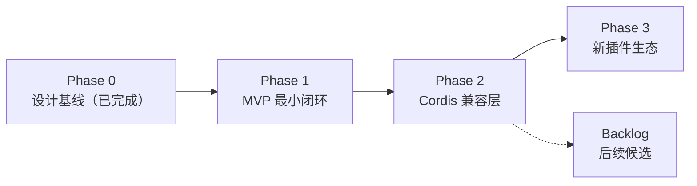

# 路线图：总览

- 状态：定稿
- 日期：2026-11-02
- 关联：[ADR-0001](../adr/ADR-0001-implementation-stack.md) ~ [ADR-0007](../adr/ADR-0007-copyright-attribution.md)；[phase-0-design-baseline.md](phase-0-design-baseline.md)

## 1. 阶段总览与看板（本表是**唯一进度看板**）

> README（中英两份）不重复看板；阶段状态只在本表维护。状态变更必须同步 CHANGELOG 与 `.agents/CONTEXT.md`。**最近更新：2026-11-03（Phase 2 切片② 施工完成：两遍观察 → 候选 + 缺项清单 → 人工审核转正的合成路径落地（`keel observe`），声明编译接进正式接线，装配收敛点 `wireCell` 让"换绑后 run 真跑"第一次被跑到；B2/B6 通过，不退化项复跑全绿）。**

| 阶段                                  | 一句话目标                                                                                                          | 参考估时* | 状态                                                                                                                                                                                                                                                                                                                                                                                                                                                                                                                                                                |
| ------------------------------------- | ------------------------------------------------------------------------------------------------------------------- | --------- | ------------------------------------------------------------------------------------------------------------------------------------------------------------------------------------------------------------------------------------------------------------------------------------------------------------------------------------------------------------------------------------------------------------------------------------------------------------------------------------------------------------------------------------------------------------------- |
| [Phase 0](phase-0-design-baseline.md) | 设计基线：治理底座 + 架构总览沉淀 + 四份关键设计定稿（Core API 契约 / Cell 隔离选型 / 补偿状态机 / 插件 manifest）  | —         | ✅ 完成（2026-11-02，验收 A1~A7 通过，见 [report](../design/phase-0/report.md)）                                                                                                                                                                                                                                                                                                                                                                                                                                                                                    |
| [Phase 1](phase-1-mvp.md)             | MVP 最小闭环：Core 四件套（调度/授权/预算/账本）+ 进程级 Cell + manifest 装配 + 补偿回退 + 策略 hook + Adapter 原型 | 8~12 周   | ✅ 完成（2026-11-02，验收 A1~A8 全通过、一票否决五项逐条实测（A1 20 舱并发、A6 真实运行归因复演为规模级补执行），交付物齐备，见 [report](../design/phase-1/report.md)；tag `phase-1.end`）                                                                                                                                                                                                                                                                                                                                                                          |
| [Phase 2](phase-2-cordis-compat.md)   | Cordis Adapter 承接存量插件全量语义（有损边界显式化）                                                               | 10~14 周  | 进行中（合同与迁移边界文档 2026-11-02 定稿：三项开工前置已确认——D 档零例外 / 合成组打底真样本补跑 / 四项回填全纳入；六片切分；tag `phase-2.start`；**切片①已完成**：设计稿定稿（ADR-0010 两项新接口）+ 施工与验收落地，B1 三主张真实多进程通过、A1 复跑三次一致；**切片②已完成**（`design/phase-2/03-manifest-synthesis.md`：两遍观察 → 候选 + 缺项清单 → 人工审核 → 五步校验，锚 B2/B6；施工含装载门 ADR-0011、装配收敛点 `wireCell`、`keel observe` 命令、声明编译接进正式接线；B2 三主张与 B6 两条通过，B8 复跑全绿），当前 = 切片③ 设计稿（C 档改法与迁移手册） |
| Phase 3                               | 新插件生态：声明式 manifest + 能力契约全面替换存量模式                                                              | 待估      | 未开始                                                                                                                                                                                                                                                                                                                                                                                                                                                                                                                                                              |

\* 单人参考值，仅量级感知。状态取值：未开始 / 进行中 / ✅ 完成（日期 + tag）。

> 阶段文档命名：`phase-N-短主题.md`；阶段状态行变更即更新本表。

## 2. 每阶段通用流程（硬流程，详见 standards/07）

1. **文档定稿**：本阶段 phase 文档及其引用设计稿从草稿转定稿（所有者知情即可，重大技术变更须 ADR）。
2. **实现**：feature 分支开发；规范全程生效。
3. **验收**：逐条执行本阶段"验收场景"，结果写入《阶段进度报告》（`design/phase-N/report.md`）。
4. **收尾**：进度报告 + 更新本看板 + CHANGELOG + ADR/架构文档回填 + 打 tag（`phase-N.end`）。

## 3. Backlog（后续阶段候选，立项须先写 ADR）

> 本节是**超范围想法的唯一通道**（standards/07 范围纪律）：一切"更好的做法/新功能构想"只记录于此、不实施。

- 容器 / microVM 隔离升级——触发：ADR-0005 的演进期条件满足（如进程级隔离被实证不足）
- 分布式部署（跨机 Cell 调度、账本分片）——触发：单机容量/可用性出现实证瓶颈（ADR-0002 重评条件）
- 账本存储引擎独立化（可换语言实现）——触发：Phase 1 吞吐基准不达标（ADR-0001 重评条件）
- 旁路计量方案（网关仅记账不转发）——触发：模型网关延迟基准不可接受（ADR-0003 重评条件）
- 策略 hook 生态扩展——触发：策略插件实际需求收敛后白名单评审
- Cell 池化与冷启动优化——触发：Cell 创建延迟影响会话并发验收用例

## 4. 风险登记簿（跨阶段）

| 风险                                  | 等级 | 对策                                                                                                                                                                                      |
| ------------------------------------- | ---- | ----------------------------------------------------------------------------------------------------------------------------------------------------------------------------------------- |
| 隔离成本：进程/容器开销影响并发与延迟 | 高   | Cell 池化 + 冷启动优化；ADR-0005 分 MVP/演进期两级决策                                                                                                                                    |
| 补偿语义退化为"日志里写一句"          | 高   | manifest 补偿声明强制可校验（C 任务验收 A5）；补偿分级（可逆/可缓解/仅记录）                                                                                                              |
| 策略 hook 变相接管控制流              | 高   | hook 白名单 + "建议/否决"型语义写入 Core API 契约（A 任务）                                                                                                                               |
| Cordis 兼容有损，迁移边界不清         | 中   | **边界文档已定稿**（[design/phase-2/01](../design/phase-2/01-cordis-migration-boundary.md)，14 条逐档归类 + D 档零例外）；承接验证落 Phase 2 验收场景 B1~B5，真样本复跑时符号回填义务重查 |
| 账本吞吐不足（fsync 频率 = 轮频率）   | 中   | ADR-0004 重评条件：有界 N 轮合并 checkpoint                                                                                                                                               |
| 模型网关成为延迟/单点瓶颈             | 中   | 流式透传设计；Phase 1 基准；旁路计量备选（backlog）                                                                                                                                       |
