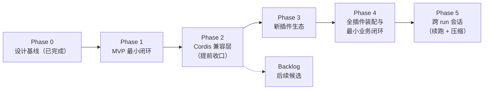

# 路线图：总览

- 状态：定稿
- 日期：2026-11-03
- 关联：[ADR-0001](../adr/ADR-0001-implementation-stack.md) ~ [ADR-0014](../adr/ADR-0014-drop-legacy-ecosystem-compat.md)；[phase-0-design-baseline.md](phase-0-design-baseline.md)

## 1. 阶段总览与看板（本表是**唯一进度看板**）

> README（中英两份）不重复看板；阶段状态只在本表维护。状态变更必须同步 CHANGELOG 与 `.agents/CONTEXT.md`。**最近更新：2026-11-04（Phase 5 立项起草——[跨 run 会话合同](phase-5-session-continuity.md) 落盘，范围 = 会话流 + 跨 run 投影 + 续跑/恢复 + 会话预算连续性 + 压缩首版，验收 E1~E7；§8 K1~K6 已确认、合同定稿；切片①四份设计稿与 ADR-0025/0026 已落盘，待第二道闸（K2 定址 / K4 压缩形状）。此前 Phase 4 验收收口（切片④完成）——`kind:"engine"` 端到端：`engine.step` 每步一往返、表面投影重算上下文、`DECISION.basedOn` 含模型事件、kill 引擎舱的故障半径与补偿回放、`keel run --profile` 接引擎驱动；D1~D7 全过、门禁 64 文件 485 测试全绿、`phase-4.end` tag 已打并 merge 到 main；此前切片③——`kind:"model"` 端到端：Core 按 manifest 价格表三桶/峰谷计价（`MODEL_USAGE` v3）、单次超预扣不把预算打成负数（`BUDGET_SETTLED{overrun:true}`）、三层治理与表面事件族落地；`model-mock` 进 CI、`model-deepseek` 手动验证不进 CI；D2/D4/D6 绿。此前切片②——Profile 装配面端到端：profile schema + 严格 YAML 子集解析器 + 六步装配 + 逐插件装配记录；manifest 扩 model/engine 两 kind 与语义校验（R9~R13）；`keel validate/run --profile` 落地；三件套改经 profile 拉起，D1-a~e 真进程断言；门禁 58 文件 442 测试全绿。此前：Phase 4 合同定稿——所有者确认 §8 K1~K6 按草稿口径通过，[合同](phase-4-profile-engine-loop.md) 由草稿转定稿（两道闸第一道已过）；其中 K3 拓扑两案对比、K5 模型调用超时/预算语义按条款留待切片①设计稿给建议后所有者拍板（第二道闸）。下一步 = 切片①：三份设计稿（profile 装配 / model kind / engine kind）+ 拓扑 ADR + 契约与 manifest 修订清单 + 禁面扫描扩展）。此前（Phase 4 立项起草——[合同草稿](phase-4-profile-engine-loop.md) 落盘待所有者评审定稿（验收 D1~D7 逐条锚五大不变量，三条一票否决；关键决策点 K1~K6 待确认）；设计输入 [research/01](../research/01-dsh-data-flow-survey.md)（DSH 关键数据流勘察，冻结）同日落盘并登记文档地图；两份新文档均登记 [docs/README](../README.md)。Phase 4 方向（所有者 2026-11-04 会话确认）：按 DSH 方式逐步长，本阶段只长 Profile 装配面 + `kind:"model"` + `kind:"engine"`（headless 闭环），会话持久化/桌面壳与 ui kind/生态件留后续；流向优先于结构——每个 seam 设计稿先钉数据流向再写结构，参照 research/01 逐条回答必答问题）。此前同日（切片⑤完成：Phase 3 验收收口——[阶段报告](../design/phase-3/report.md) 定稿，C1~C7 逐条复核全过（三条一票否决项达成）；规范回填复核补两处注记（契约 §4.8 hook① 入参形状、manifest 稿 R4 生命周期导出面）；插件开销基准 B6（治理满配 ~1ms、策略插话 0.2ms，只测不设阈值）；修正 bench B6 段策略舱未回收导致进程不退出；六道门禁 56 文件 420 测试全绿；**`phase-3.end` tag 决定权归所有者**）。此前（切片④完成：插件 B `file-write` 转正 + 插件 C `param-guard` 落地，三件套闭环——[08 稿](../design/phase-3/08-plugin-b-c.md) 两道闸定稿（K1~K5 所有者确认）；B 纯 handler + 收据底座补 C3【一票否决】真进程补偿闭环（B-E1~E5 红测先行：注入故障 → 内建 `fs.remove` 只删本次创建 → 账本全链可归因；越界拒零部分生效；重试幂等；预存在目标 0 误删），C 经 `toolApproval` 否决内容模式危险参数补 C4（介入 seq 进 `DECISION.basedOn` 可归因；杀策略舱 → 既有 fallback 不级联，C-E1~E4）；禁面扫描三件零命中 + `REVIEW.md` ×2 转正留痕；修正 vitest include 缺层（echo 包内单测此前未被主线收集）；六道门禁 56 文件 420 测试全绿）。此前（2026-11-03，切片③完成：Cell-Runtime AOP + 内置补偿落地——首个原生插件 `echo` 端到端落地（[03 稿](../design/phase-3/03-plugin-a-echo.md) 两道闸定稿；E1~E6 真进程验收全绿，锚 C1【一票否决】/C5/C6），处置内核缺口 F4（默认入口补静态工具发布，ADR-0011 带日期注记），集成面收口（CLI 五处 + 8 个 rig），六道门禁 43 文件 344 测试全绿。**

**同日早前（Phase 3 开工）：所有者四项决定当天落地——`phase-2.end` tag 已打（附言所有者定稿）；cordis 测试剥离主线门禁（文件留库加归档横幅，内核命名测试保留）；[phase-3 合同](phase-3-native-ecosystem.md) 定稿：首批 = 底层测试驱动三件套（echo / file-write / param-guard），验收 C1~C7 逐条锚五大不变量；评审机械化落地（[design/phase-3/02](../design/phase-3/02-review-mechanization.md)：禁面扫描器 + 负样本门禁测试，红测先行），切片①完成；[ADR-0014](../adr/ADR-0014-drop-legacy-ecosystem-compat.md) 放弃全面兼容 DSH 旧生态，Phase 2 提前收口（处置表见 [合同 §8](phase-2-cordis-compat.md)）。**

**同日稍后（R1~R5 完成）：** 所有者批准 [07 稿](../design/phase-3/07-runtime-context-refactor.md) 后，运行上下文重构落地——新增零依赖 `@keel/runtime-context`（`EffectScope` / `RunContext`），Core `ContextManager` 拆为 `ToolCatalog` + `PageStore`；新增受治理 `workspace.write` 与效果收据，`fs.remove` 只删“本次创建且 identity 相符”的文件；插件 `setup/effect/dispose` 生命周期、`toolCallId` 重试幂等、多 effect 独立结算；spawn 环境白名单、工作区 cwd、manifest trust 申请/宿主授予。决策 = [ADR-0017](../adr/ADR-0017-runtime-context-layering.md) / [0018](../adr/ADR-0018-effect-receipts-and-workspace.md) / [0019](../adr/ADR-0019-trust-tiers-and-cell-isolation.md) / [0020](../adr/ADR-0020-workspace-error-codes.md)；证据见 07 稿 §13。下一片 = 切片④（插件 B/C）。

| 阶段                                      | 一句话目标                                                                                                          | 参考估时* | 状态                                                                                                                                                                                                                                                                                                                                                                                                                                                                                                                                                                                                                                                                                                                                                                                                                                                                                                                                                                                                                                                                                                                                                                                                                                                                                                                                                                                                                         |
| ----------------------------------------- | ------------------------------------------------------------------------------------------------------------------- | --------- | ---------------------------------------------------------------------------------------------------------------------------------------------------------------------------------------------------------------------------------------------------------------------------------------------------------------------------------------------------------------------------------------------------------------------------------------------------------------------------------------------------------------------------------------------------------------------------------------------------------------------------------------------------------------------------------------------------------------------------------------------------------------------------------------------------------------------------------------------------------------------------------------------------------------------------------------------------------------------------------------------------------------------------------------------------------------------------------------------------------------------------------------------------------------------------------------------------------------------------------------------------------------------------------------------------------------------------------------------------------------------------------------------------------------------------- |
| [Phase 0](phase-0-design-baseline.md)     | 设计基线：治理底座 + 架构总览沉淀 + 四份关键设计定稿（Core API 契约 / Cell 隔离选型 / 补偿状态机 / 插件 manifest）  | —         | ✅ 完成（2026-11-02，验收 A1~A7 通过，见 [report](../design/phase-0/report.md)）                                                                                                                                                                                                                                                                                                                                                                                                                                                                                                                                                                                                                                                                                                                                                                                                                                                                                                                                                                                                                                                                                                                                                                                                                                                                                                                                             |
| [Phase 1](phase-1-mvp.md)                 | MVP 最小闭环：Core 四件套（调度/授权/预算/账本）+ 进程级 Cell + manifest 装配 + 补偿回退 + 策略 hook + Adapter 原型 | 8~12 周   | ✅ 完成（2026-11-02，验收 A1~A8 全通过、一票否决五项逐条实测（A1 20 舱并发、A6 真实运行归因复演为规模级补执行），交付物齐备，见 [report](../design/phase-1/report.md)；tag `phase-1.end`）                                                                                                                                                                                                                                                                                                                                                                                                                                                                                                                                                                                                                                                                                                                                                                                                                                                                                                                                                                                                                                                                                                                                                                                                                                   |
| [Phase 2](phase-2-cordis-compat.md)       | Cordis Adapter 承接存量插件全量语义（有损边界显式化）                                                               | 10~14 周  | **提前收口**（2026-11-03，所有者决定，见 [ADR-0014](../adr/ADR-0014-drop-legacy-ecosystem-compat.md)）：切片①~⑤ 全部完成并逐片验收（B1/B2/B3/B4【一票否决】/B6/B7①~⑤ 达成，B8 全库复跑 431 项/53 文件全绿），切片⑥ 第一批真样本显示三枚真实第三方插件全部死在装载层、12 个旧形状触点无归属，**B5 判为未通过**（[design/phase-2/08](../design/phase-2/08-real-sample-observation.md)）——叠加三条战略理由（旧生态形态持续漂移 / Keel 定位是少而精的需求驱动底座 / 旧插件野路子违背核心不变量），提前终止兼容任务；**逐项处置表见合同 §8**：边界表冻结（候选行 #16~#26 不回填）、B5 作废、切片⑥ 终止、adapter 归档不删（兼容层测试保留为内核通道 op 的唯一真进程证据链）、真发现转反面教材（[design/phase-3/01](../design/phase-3/01-legacy-anti-patterns.md)）；`phase-2.end` 是否打 tag 归所有者                                                                                                                                                                                                                                                                                                                                                                                                                                                                                                                                                                                                                              |
| Phase 3                                   | 新插件生态：声明式 manifest + 能力契约全面替换存量模式                                                              | 待估      | 进行中（验收收口：合同 [phase-3-native-ecosystem.md](phase-3-native-ecosystem.md) 2026-11-03 定稿，ADR-0014 实施注记四项决定：首批 = **底层测试驱动三件套** echo / file-write / param-guard，验收 C1~C7 逐条锚五大不变量，业务层场景移 Phase 4/backlog；cordis 测试已剥离主线门禁，`phase-2.end` tag 已打；评审机械化已落地（[design/phase-3/02](../design/phase-3/02-review-mechanization.md)：禁面扫描器 + 负样本门禁测试，红测先行），切片①完成——**切片②已完成**（[03 稿](../design/phase-3/03-plugin-a-echo.md)：插件 A `echo` 端到端 + 内核静态工具发布缺口处置，REVIEW.md 留痕）；**2026-11-03 切片③完成**：Cell-Runtime AOP + 内置补偿落地（04/05/06 稿 + ADR-0015/0016；纯 handler 自动 guard/声明，内建 `fs.remove` 零撤销代码，record-only 极简声明；真进程 A1~A3 全绿）；**切片③.5 完成**：运行上下文重构 R1~R5（07 稿 + ADR-0017/0018/0019/0020；受治理 Workspace + 效果收据、`ToolCatalog`/`PageStore`、生命周期/幂等、env/cwd/trust）；**切片④完成（2026-11-04）**：插件 B/C 转正（[08 稿](../design/phase-3/08-plugin-b-c.md)：B 纯 handler + 收据底座补 C3【一票否决】、C 经 `toolApproval` 补 C4、C2 三件套留痕齐 + 扫描零命中；e2e 红测先行；vitest include 缺层修正）；**切片⑤完成（2026-11-04）**：验收复核 + 报告收口（[report](../design/phase-3/report.md)：C1~C7 全过、规范回填两处注记、B6 插件开销基准；`phase-3.end` 待所有者）                                                                   |
| [Phase 4](phase-4-profile-engine-loop.md) | 全插件装配与最小业务闭环：Profile 装配面 + `kind:"model"` + `kind:"engine"`（headless 全家桶闭环）                  | 待估      | ✅ **完成（2026-11-04，tag `phase-4.end`）**；切片②：Profile 装配面端到端——[profile schema](../design/phase-4/schema/keel-profile.schema.json) + 严格 YAML 子集解析器 + 六步装配（`packages/host/src/profile/`）+ 逐插件装配记录（契约 §5 R2）；manifest schema 五 kind + model/engine 两段（R9/R10/R11/R12）+ 装配器语义校验（R13）；三件套改经 profile 拉起、五 kind 隔离环境与跨 scope 回归真进程验证（D1-a~e），`keel validate/run --profile` 落地（engine 驱动留切片④）；门禁 58 文件 442 测试全绿。切片①（合同+四稿+ADR-0021~0024+禁面扫描）同上轮完成。**切片③完成（2026-11-04）**：`kind:"model"` 端到端——Core 按 manifest 价格表三桶/峰谷计价（`MODEL_USAGE` v3）、单次超预扣夹到限额（`BUDGET_SETTLED` v2 `overrun`）、非流式 120s/流式断流/模块内空闲看门狗三层治理、表面事件族 `TURN_INPUT`/`MODEL_MESSAGE` + 白名单；`model-mock` 进 CI（6 单测 + `tests/model-kind-e2e.test.ts` 12 例）、`model-deepseek` 手动验证不进 CI（2026-11-04 密钥到位后已执行：invoke + stream 各一次成功）；覆盖 D2/D4/D6。**切片④完成（2026-11-04）**：`kind:"engine"` 端到端——`engine.step` 每步一往返（决策在 Cell、推进与工具执行在 Core）、表面投影重算上下文、`DECISION.basedOn` 含模型事件、kill 引擎舱的故障半径与补偿回放、`keel run --profile` 接引擎驱动；`engine-react` 标杆 + 9 例真进程 e2e + 4 例单测 + CLI 冒烟；D1~D7 复核全过，实施期修正 P-022；**Phase 4 验收收口，`phase-4.end` tag 与分支 merge 时机归所有者** |
| [Phase 5](phase-5-session-continuity.md)  | 跨 run 会话：续跑 + 崩溃恢复 + 压缩（把会话从信封字段长成一等事实）                                                 | 待估      | **合同定稿（2026-11-04，K1~K6 确认）**：范围 = 会话流（跨 run 读取面 + 复合游标 + run 序号/单活）+ 跨 run 表面投影 + 续跑与崩溃恢复统一入口 + 会话预算连续性 + 压缩首版（`surfaceOp` 落地、摘要走 model seam、原始事件永留可还原）；验收 E1~E7（E1/E2/E3 三条一票否决）；不做 fork/回滚、留存删除、自动压缩调度、UI、多 Agent、会话导出；两道闸第二道：K2（复合键 vs 扁平 seq，ADR-0025）与 K4（surfaceOp vs 新事件，ADR-0026）由设计稿给建议、所有者拍板；**切片①设计稿已落盘（01~04 + ADR-0025/0026），待第二道闸**                                                                                                                                                                                                                                                                                                                                                                                                                                                                                                                                                                                                                                                                                                                                                                                                                                                                                                        |

\* 单人参考值，仅量级感知。状态取值：未开始 / 进行中 / ✅ 完成（日期 + tag）。

> 阶段文档命名：`phase-N-短主题.md`；阶段状态行变更即更新本表。

## 2. 每阶段通用流程（硬流程，详见 standards/07）

1. **文档定稿**：本阶段 phase 文档及其引用设计稿从草稿转定稿（所有者知情即可，重大技术变更须 ADR）。
2. **实现**：feature 分支开发；规范全程生效。
3. **验收**：逐条执行本阶段"验收场景"，结果写入《阶段进度报告》（`design/phase-N/report.md`）。
4. **收尾**：进度报告 + 更新本看板 + CHANGELOG + ADR/架构文档回填 + 打 tag（`phase-N.end`）。

## 3. Backlog（后续阶段候选，立项须先写 ADR）

> 本节是**超范围想法的唯一通道**（standards/07 范围纪律）：一切"更好的做法/新功能构想"只记录于此、不实施。

- 容器 / microVM 隔离升级——触发：ADR-0005 的演进期条件满足（如进程级隔离被实证不足）
- 分布式部署（跨机 Cell 调度、账本分片）——触发：单机容量/可用性出现实证瓶颈（ADR-0002 重评条件）
- 账本存储引擎独立化（可换语言实现）——触发：Phase 1 吞吐基准不达标（ADR-0001 重评条件）
- 旁路计量方案（网关仅记账不转发）——触发：模型网关延迟基准不可接受（ADR-0003 重评条件）
- 策略 hook 生态扩展——触发：策略插件实际需求收敛后白名单评审
- Cell 池化与冷启动优化——触发：Cell 创建延迟影响会话并发验收用例
- 会话 fork / 回滚（任意 seq 开子会话）——触发：长程任务出现"试错分支"的实证需求（DSH 的回滚替代物，Phase 5 明确不做）
- 账本留存与 GC / 冷归档——触发：单会话账本体积实测影响读取性能或磁盘预算（Phase 5 只定观测与阈值，不删字节）
- 压缩的自动调度（换模型 / overflow 恢复 / 压力触发）——触发：Phase 5 的手动 + 阈值在实际使用中不够用
- 会话导出 / 迁移（ACP/SDK 形态）——触发：出现跨工具接续会话的需求

## 4. 风险登记簿（跨阶段）

| 风险                                             | 等级 | 对策                                                                                                                                                                                                                                            |
| ------------------------------------------------ | ---- | ----------------------------------------------------------------------------------------------------------------------------------------------------------------------------------------------------------------------------------------------- |
| 隔离成本：进程/容器开销影响并发与延迟            | 高   | Cell 池化 + 冷启动优化；ADR-0005 分 MVP/演进期两级决策                                                                                                                                                                                          |
| 补偿语义退化为"日志里写一句"                     | 高   | manifest 补偿声明强制可校验（C 任务验收 A5）；补偿分级（可逆/可缓解/仅记录）                                                                                                                                                                    |
| 策略 hook 变相接管控制流                         | 高   | hook 白名单 + "建议/否决"型语义写入 Core API 契约（A 任务）                                                                                                                                                                                     |
| Cordis 兼容有损，迁移边界不清                    | 中   | **已由战略转向处置**（[ADR-0014](../adr/ADR-0014-drop-legacy-ecosystem-compat.md)）：不再追求全面兼容，Phase 2 提前收口，边界表冻结；旧生态问题沉淀为 Phase 3 评审反面教材（[design/phase-3/01](../design/phase-3/01-legacy-anti-patterns.md)） |
| 账本吞吐不足（fsync 频率 = 轮频率）              | 中   | ADR-0004 重评条件：有界 N 轮合并 checkpoint                                                                                                                                                                                                     |
| 模型网关成为延迟/单点瓶颈                        | 中   | 流式透传设计；Phase 1 基准；旁路计量备选（backlog）                                                                                                                                                                                             |
| AOP 治理声明与代码行为不一致 / 被误当沙箱        | 中   | 计划由宿主从 manifest 纯编译；`markReady` 校验计划点名的工具已登记；AOP 只约束守规矩的插件，真正边界仍是 Cell 隔离 + manifest 授权 + 评审（[04 稿](../design/phase-3/04-cell-runtime-aop.md) §9）                                               |
| manifest `governance` 扩展成为长期契约负担       | 中   | 已由 ADR-0015 定稿；只支持顶层字段名，不引入表达式语言；Schema + 装配器语义校验；兼容期不强制 Cordis 件                                                                                                                                         |
| 内置补偿被误用（`fs.remove` 删除覆盖写的旧内容） | 中   | 文档明确仅适用于“本次新建的文件”；覆盖写走 record-only 或插件补偿；路径按本 run `fs.write.allow` 复核；`fs.restore` 登记 backlog（[05 稿](../design/phase-3/05-builtin-compensation.md) §6）                                                    |
| 跨 run 会话顺序被并发破坏                        | 中   | 单活租约（跨进程）+ 拒绝零写入 + 会话内 run 序号落账本 + 真进程用例（Phase 5 E6）                                                                                                                                                               |
| 压缩摘要被当成"新事实"进入归因                   | 中   | 摘要只进模型视图、永不进治理链；原始事件永留；"忽略压缩"的还原模式与"治理事件不进摘要输入"机械断言（Phase 5 E3）                                                                                                                                |
